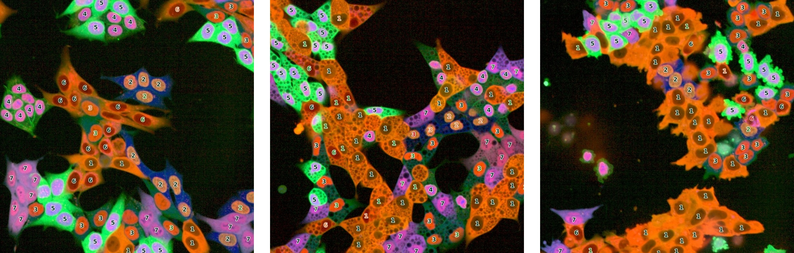
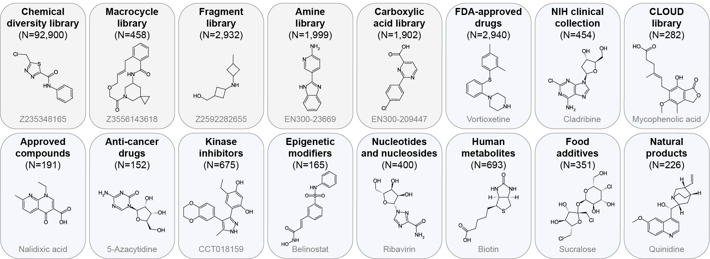
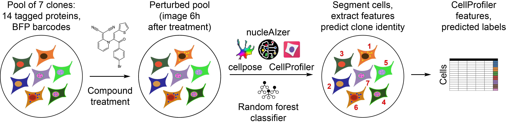
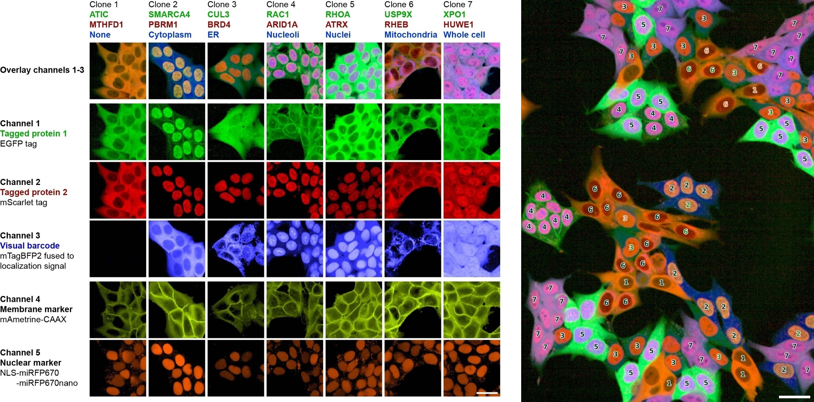

# Dataset: morphological profiling of >100,000 compounds with vpCell pool of 7 clones

This repository contains download instructions for a morphological profiling dataset of over 100,000 chemical perturbations screened against a pool of seven multicolor-labeled clones. The data was generated by the [Kubicek Laboratory](https://cemm.at/research/groups/core-groups/stefan-kubicek/research) and the Molecular Discovery Platform at CeMM in Vienna, Austria. A full description of the analysis will be provided in the manuscript *High-throughput vpCells phenotyping for target-specific and global effects of 100,000 compounds*, which is currently under revision.

<!-- &nbsp; -->

### Dataset statistics:
- 325 measurements (Opera Phenix imaging runs)  
- 124,800 wells = 106,720 screening compound treatments + controls
- 615,547 fields of view
- 83,048,075 segmented cells after quality filtering

### Experimental setup & data processing overview

HAP1 cells were imaged 6 hours after compound treatment with an Opera Phenix high-content confocal microscopy system with water immersion objective (40× magnification), capturing images at 1,080 × 1,080 pixel resolution. We imaged 5 fields of view (FOVs) per well, with the exception of an initial batch of plates (2340001 through 2340011, with 3 FOVs per well). For each field of view, we imaged five fluorescent channels:

| Channel name (fluorophore) | Description | Channel number (FFC-corrected images folder, analysis) | Channel number (raw images folder only) |
| :--- | :--- | :--- | :---- |
| GFP | Tagged protein of interest   1 | 1 | 3 |
| mScarlet | Tagged protein of interest 2 | 2 | 5 |
| BFP | Visual barcode / organelle marker | 3 | 1 |
| mAmetrine | Membrane marker | 4 | 2 |
| miRFP | Nuclear marker | 5 | 4 |

Our pooled vpCells approach to morphological profiling differs from traditional protocols like Cell Painting: instead of applying the same set of dyes to all assayed cells, we profile a heterogeneous population of cells consisting of 7 clones, each expressing multiple fluorescently labeled proteins. This represents a large increase in information content: we capture the effects of compounds on 14 fluorescent fusion proteins and 8 organelle markers expressed by the cells. However, our approach requires a demultiplexing step - we use a random forest model trained on CellProfiler features to assign clone labels to detected cells.

The data processing pipeline has been published in a [separate GitHub repository](https://github.com/Kubicek-Lab-at-CeMM/vpCells_pool_of_7). Segmentation was performed with cellpose and nucleAIzer, features were extracted using CellProfiler. A random forest model was used to predict clone identity based on the CellProfiler features.

### Dataset structure description

The dataset comprises **325 measurements**, each corresponding to one 384-well microplate. For each measurement, three files are provided:
1. Data zip file (e.g., `2340006__2023-11-17T03_16_52-Measurement_1.zip`)
2. Filelist with names of folders/files in the zip file (e.g., `2340006__2023-11-17T03_16_52-Measurement_1.zip.filelist`)
3. sha256 checksum of the data zip file  (e.g., `2340006__2023-11-17T03_16_52-Measurement_1.zip.sha256`)

#### Each measurement contains the following folders:
- `Images`: raw images
    - one tiff file for each image and channel, with the following naming convention (listing relevant fields only):
    - example: `r11c06f04p01-ch3sk1fk1fl1.tiff`
        - `r11`: row 11 of the plate
        - `c06`: column 6 of the plate
        - `f04`: field 4 (imaging position within the well)
        - `ch3`: channel 3
    - please note that channels were assigned new numbers in the analysis, for legacy reasons
- `FFC_Profile`: contains an XML file with parameters for flatfield correction
- `Images_FFC`:  flatfield-corrected images in tiff format, generated with the Harmony software provided by the instrument manufacturer (Revvity); the algorithm is described [here](https://onlinelibrary.wiley.com/doi/10.1111/jmi.12404).
    - please note that channel numbers here differ from those in the raw images folder (see table above)
- `Images_segmented`: segmentation masks in png format
    - `ch4sk1fk1fl1_segmented_mask.png`: cellpose segmentation masks of entire cells from membrane marker (channel 4, mAmetrine)
	- `ch5sk1fk1fl1_segmented_mask.png`: nuclAIzer segmentation masks of nuclei from nuclear marker (channel 5, miRFP)
	- `_filtered_cells.png`: masks of entire cells after 1:1 mapping to nuclei and quality filtering
	- `_filtered_nuclei.png`: masks of nuclei after 1:1 to cells and quality filtering
	- `_filtered_cytoplasm.png`: masks of the cytoplasmic part of the cell object (entire cell minus nucleus) for cells that passed 1:1 mapping and quality filtering
- `CellProfiler_measurements`: CellProfiler features extracted for cells and images
- `Predictions_CellProfiler_RF`: single-cell level clone identity predictions from random forest model calculated from CellProfiler features

### Metadata file

The metadata  specifies which compound treatments were carried out. The table below shows a tiny sample. The file contains the following fields:
- `well_ID`: unique number of row
- `plate`: number assigned to the 384-well microplate
- `measurement`: measurement name, contains the plate number and timestamp
- `well`: position of the well within the plate
- `row`: row number of the well 
- `column`:  column number of the well
- `compound`: name of the compound
- `AssayConc_uM`: concentration of the compound in micromolar
- `Type`: well type - either screening compound (Cpd), DMSO negative control (DMSO), positive control dBET6 (PosCon), no treatment control (NoTreatment)
- `Transfer`: indicated whether compound was successfully transferred to the screening plate, YES/NO
- `is_control`: indicates if well is a control
- `measurement_batch`: batch number of the measurement
- `Sublibrary`: describes which subset of the library the compound belongs to

|   well_ID |   plate | measurement                                    | well   |   row |   column | compound               |   AssayConc_uM | Type   | Transfer   |   measurement_batch | Sublibrary                                |
|----------:|--------:|:-----------------------------------------------|:-------|------:|---------:|:-----------------------|---------------:|:-------|:-----------|--------------------:|:------------------------------------------|
|     13658 | 2340036 | 2340036__2023-12-03T00_43_50-Measurement_1_FFC | J03    |    10 |        3 | T0507-2811             |             10 | Cpd    | YES        |                   9 | Chemical diversity library                |
|    100000 | 2340260 | 2340260__2023-12-01T04_39_37-Measurement_1_FFC | G17    |     7 |       17 | Z1365493293            |             10 | Cpd    | YES        |                   7 | Chemical diversity library, cytotoxic set |
|     99641 | 2340259 | 2340259__2023-12-01T03_06_30-Measurement_1_FFC | H18    |     8 |       18 | Tryptamine             |             10 | Cpd    | YES        |                   7 | Natural products                          |
|    103207 | 2340268 | 2340268__2023-12-02T07_26_58-Measurement_1_FFC | M08    |    13 |        8 | Janex 1                |             10 | Cpd    | YES        |                   8 | Kinase inhibitors                         |
|    118349 | 2340308 | 2340308__2025-01-11T07_36_28-Measurement_1_FFC | D06    |     4 |        6 | Troxerutin             |             10 | Cpd    | YES        |                  48 | FDA-approved drugs                        |
|    118390 | 2340308 | 2340308__2025-01-11T07_36_28-Measurement_1_FFC | E23    |     5 |       23 | Gemigliptin (tartrate) |             10 | Cpd    | YES        |                  48 | FDA-approved drugs                        |
|    110103 | 2340286 | 2340286__2025-01-17T00_23_44-Measurement_3_FFC | L16    |    12 |       16 | dBET6                  |             10 | PosCon | YES        |                  50 | Other (controls)                          |
|     18678 | 2340049 | 2340049__2023-12-08T01_34_26-Measurement_1_FFC | K07    |    11 |        7 | DMSO                   |            nan | DMSO   | YES        |                  11 | Other (controls)                          |
